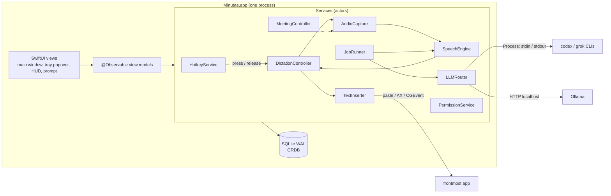
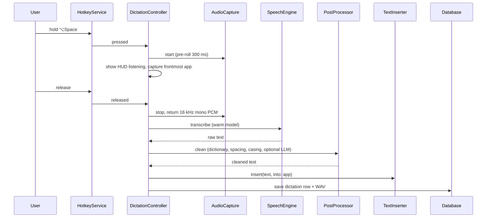

# Minutae — Target Architecture (v3, native Swift)

Status: **decided 2026-11-13.** Supersedes v2 (Tauri + Rust + React). Evidence: `docs/spike-01-results.md` (SPIKE-01, PR #3) and `docs/llm-providers.md` (LLM-01).

Owner of this document: the design and architecture agent. The implementing agent builds it and does not change it. Missing decisions go in the PR description.

## 0. Decisions

| # | Decision | Source |
|---|---|---|
| 1 | Native macOS app in **Swift 6, SwiftUI with AppKit where needed**. Tauri, Rust and React are retired once Swift reaches parity. | owner, 2026-11-13 |
| 2 | Minimum macOS **14.4**. Apple Silicon first. | owner |
| 3 | AI without API keys: **`codex-cli`, `grok-cli`, `ollama`**, plus optional Advanced **`api`** transport (Keychain). Claude CLI (terms), Cursor and Gemini (unavailable) are not built. | LLM-01 |
| 4 | Dictation hotkey: hold **⌥Space**, user-changeable. Fallback chord if Option-only registration fails on an OS. | owner, SPIKE-01 |
| 5 | Dictation audio kept by default. Every dictation is logged in the app. | owner |
| 6 | Look: "Ink & signal" riso theme from Paper, light only. Dark variant is deferred. | owner |
| 7 | Not sandboxed. **No paid Apple Developer account** (owner, 2026-11-13): builds are signed with a free Apple Development certificate (stable TCC grants) and distributed unnotarised; hardened runtime on. Sparkle updates stay optional. | owner |

Open (owner must answer, see §11): Codex model name, WhisperKit download policy, 14.4 test device.

## 1. Principles

1. Local first. Audio, transcripts, summaries and the database live in `~/Library/Minutae/`.
2. Open and hackable. Summaries stay plain `.md` files with YAML frontmatter.
3. Every external capability sits behind a Swift protocol (`SpeechEngine`, `LLMTransport`, `TextInserter`, `AudioSource`) so it can be swapped and faked in tests.
4. Never read another app's credentials. We spawn the vendor's own CLI and use its login.
5. Degrade gracefully: every permission can be denied and the app still works for what remains.
6. The UI never blocks on work. Heavy work runs in actors and jobs. Views read observable state.

## 2. What exists today (Tauri app, to be replaced)

React 19 UI, Tailwind v4, Zustand, TanStack Router, SQLite via Drizzle, whisper.cpp as a CLI binary, API-key AI providers, a Rust shell with mic detection and file commands. It runs on `main`. **Compatibility rule:** the new app must open the existing `~/Library/Minutae/minutae.db`, recordings and summary files without data loss (see `MIG-01`).

## 3. System overview



Caption: one process; services are actors; the only outward paths are vendor CLIs, local Ollama, and the focused app.

### 3.1 Windows and surfaces

| Surface | Implementation | Notes |
|---|---|---|
| Main window | SwiftUI `Window` with custom sidebar (`NavigationSplitView` styled to the design) | closes to background, app keeps running |
| Menu-bar item | `NSStatusItem` with template icon (idle and recording variants) | `MenuBarExtra` rejected: its menu cannot match the design (SPIKE-01 §7) |
| Tray popover | custom `NSPanel` anchored under the status item, SwiftUI content | soft-shadow style from DS-01 |
| Dictation HUD | non-activating `NSPanel`, `.canJoinAllSpaces`, `.fullScreenAuxiliary`, ignores mouse | proven not to steal focus (SPIKE-01 §2) |
| Meeting prompt | non-activating `NSPanel` near top right | |
| Recording pill | `NSPanel` | |
| Search and ask | SwiftUI sheet in main window (⌘K) | |

### 3.2 State ownership

Services own state and persistence. View models are `@Observable` and hold only presentation state. Database changes are observed with GRDB `ValueObservation`. No view writes SQL.

## 4. Module layout

One Xcode project, local Swift packages under `Packages/`, one app target.

```
Minutae.xcodeproj
App/                      # @main, AppDelegate, window and panel setup, DI container
Packages/
  MinutaeCore/            # models, GRDB database, migrations, JobRunner, Settings, Keychain, Logging
  MinutaeAudio/           # AVAudioEngine mic capture, Core Audio process taps, WAV writer, ring buffer, VAD
  MinutaeSpeech/          # SpeechEngine protocol, WhisperCppEngine, (WhisperKitEngine behind same protocol), model manager
  MinutaeLLM/             # LLMTransport protocol, SubprocessRunner, Codex/Grok/Ollama/API transports, LLMRouter, prompts
  MinutaeDictation/       # HotkeyService, DictationController, TextInserter, PostProcessor, Dictionary
  MinutaeMeetings/        # MeetingController, detection, calendar, summarisation pipeline, markdown export
  MinutaeLibrary/         # search (FTS5 + embeddings), retention, export, transcript edits
  MinutaeDesign/          # tokens, fonts, components (Pill, Card, Button, Toggle, NavItem, HUD)
  MinutaeFeatures/        # SwiftUI screens and view models, one folder per screen
Tests/                    # Swift Testing / XCTest per package
legacy/                   # old Tauri app, until MIG-02
docs/
```

Rules: `MinutaeCore` imports nothing from siblings. Features import services through protocols. No package imports `MinutaeFeatures`. Swift 6 language mode, strict concurrency on.

## 5. Subsystem: AI without API keys (LLM bridge)

### 5.1 Decision record

- A consumer subscription cannot be called as an HTTP API. What exists is each vendor's own CLI, logged in as the user. Minutae spawns that CLI headless and passes text in and out. It never reads a vendor's token files.
- LLM-01 verdicts: Claude no-go (terms), Cursor and Gemini unavailable, Codex go once a model is pinned, Grok go, Ollama go. Ollama has no installed local model on the owner's machine; the app must offer to pull a small one.
- The API-key transport stays as an Advanced option, key in Keychain only.

### 5.2 Interface

```swift
public enum TransportID: String, Codable, Sendable { case codexCLI, grokCLI, ollama, api }

public struct LLMRequest: Sendable {
    var system: String?
    var prompt: String
    var jsonSchema: Data?        // optional: ask for JSON
    var maxOutputTokens: Int?
    var timeout: Duration
    var purpose: Purpose         // summary, title, cleanup, ask, …
}

public struct LLMResponse: Sendable {
    var text: String
    var transport: TransportID
    var model: String?
    var usage: Usage?
    var duration: Duration
}

public enum LLMError: Error, Sendable {
    case notInstalled, notLoggedIn, rateLimited(retryAfter: Duration?), timeout,
         cancelled, invalidOutput(String), modelRejected(String), unavailable(String)
}

public protocol LLMTransport: Sendable {
    var id: TransportID { get }
    func status() async -> TransportStatus      // installed, signed in, model, version
    func run(_ request: LLMRequest) async throws -> LLMResponse
}
```

```swift
public enum Purpose: String, Codable, Sendable {
    case summary, title, cleanup, ask, test      // test = Settings "Test" action
}

public struct Usage: Codable, Sendable, Equatable {
    var inputTokens: Int?       // nil when the CLI does not report it
    var outputTokens: Int?
    var costUSD: Double?        // only ever set by the api transport
}

public struct TransportStatus: Sendable, Equatable {
    var installed: Bool
    var binaryPath: String?     // resolved real path, nil if not installed
    var signedIn: Bool?         // nil = unknown / not checkable cheaply
    var model: String?          // pinned/selected model, nil if none
    var version: String?
    var detail: String?         // human-readable note for the Settings row
}
```

`LLMRouter` holds the user's ordered fallback chain, tries each available transport, falls back on `notInstalled`, `notLoggedIn`, `rateLimited`, `timeout` and `modelRejected`, never on `cancelled`. JSON mode validates with `Codable` and makes one repair retry. Long transcripts use map-reduce chunking.

### 5.3 Subprocess rules (all CLI transports)

Use the exact flags recorded in `docs/llm-providers.md`. Run the real binary path (never a shell function). Prompt on stdin or a temp file. Empty `0700` temp working directory, removed afterwards. Tools disabled, no session persistence, no skip-permission flags, user config ignored where the CLI supports it. Hard timeout, cancel via `Process.terminate()`, one call in flight per transport. Capture stdout and stderr, parse into `LLMResponse` or classify into `LLMError`; never log prompts or transcripts above debug level. The Codex model comes from a `codexModel` setting passed with `--model`; the Test action shows the classified error if it is empty or rejected.

### 5.4 Usage accounting

`api_usage_log` gains `transport`, `duration_ms`, `error_class`. The Usage page shows "AI calls", success rate and average time per transport. Dollar cost is shown only for the `api` transport.

## 6. Subsystem: system-wide dictation

### 6.1 Experience

Hold ⌥Space in any app. The HUD shows "listening" with a level meter, you speak, you release, the HUD shows "processing", and the cleaned text appears at the cursor in the frontmost app. If insertion is impossible (secure field, no Accessibility), the text is copied to the clipboard and the HUD says so. Every dictation is saved with its audio, raw text, cleaned text, target app and timing, and appears in the Library.

### 6.2 Pipeline



Caption: press to start capture, release to transcribe, clean and insert; the database write is the last step and never blocks insertion.

### 6.3 Components

| Component | Behaviour |
|---|---|
| HotkeyService | Carbon `RegisterEventHotKey` for ⌥Space (no Input Monitoring needed). Press and release events. Toggle mode as a setting. User-changeable chord. If registration fails, surface it and suggest a fallback chord. |
| AudioCapture | `AVAudioEngine` input tap, ring buffer with pre-roll, VAD trims silence, converts to 16 kHz mono Float32, writes WAV incrementally. |
| SpeechEngine | Protocol. Default `WhisperCppEngine` linked as a library, model loaded once and kept warm in an actor, unloaded after N idle minutes. `WhisperKitEngine` may be added behind the same protocol (see `SPEECH-02`). Language auto or fixed. |
| PostProcessor | Local first: trim, fix spacing and capitals, user dictionary replacements, snippets. Optional LLM cleanup through the router, off by default for latency. |
| TextInserter | In order: pasteboard plus ⌘V with the full pasteboard saved and restored; Accessibility selected-text insertion; `CGEvent` typing. Refuses when `IsSecureEventInputEnabled()` is true. Records which method worked per app. |
| DictationController | Actor state machine: idle, listening, processing, inserting, error. One dictation at a time. Cancel on Esc. |

### 6.4 Conflicts to handle

- Option+Space must not type a non-breaking space into the focused app. Verified by `DIC-01` in TextEdit, Notes, Safari, VS Code and Slack.
- Dictating while a meeting is recording shares the mic: one `AVAudioEngine`, two consumers.
- Another app already owns the chord: show which chord failed and offer the fallback.
- Option-only hotkeys have changed behaviour across macOS 15 releases. Must be tested on 14.4 and the current OS before shipping.

## 7. Subsystem: transcripts and library

### 7.1 Data model

GRDB over the same SQLite file in WAL mode. Existing tables stay: `meetings`, `recordings`, `transcripts`, `segments`, `summaries`, `action_items`, `embeddings`, `api_usage_log`, `settings`. New in schema v2:

| Table | Purpose |
|---|---|
| `dictations` | id, started_at, duration_ms, target_app_bundle_id, target_app_name, raw_text, final_text, insert_method, status, audio_path, error |
| `jobs` | id, kind, subject_type, subject_id, payload, state, attempts, last_error, created_at, updated_at |
| `tags`, `item_tags` | tags on meetings and dictations |
| `dictionary` | term, replacement, kind (word, snippet), scope |
| `transcript_edits` | segment_id, original, edited, edited_at (edits never overwrite the original) |

`api_usage_log` adds `transport`, `duration_ms`, `error_class`. Migrations use GRDB `DatabaseMigrator`; the first migration recognises a database created by the Tauri app and brings it to v2 without data loss.

#### 7.1.1 Schema v2 (normative)

Conventions, matching the existing tables: ids are lowercase UUID strings (`TEXT PRIMARY KEY NOT NULL`); timestamps are ISO-8601 UTC strings; booleans are `INTEGER` 0 or 1; foreign keys are enforced; JSON is stored as `TEXT`. Migration v2 only adds. It never alters or drops v1 tables except `ALTER TABLE api_usage_log ADD COLUMN`.

```sql
CREATE TABLE dictations (
  id TEXT PRIMARY KEY NOT NULL,
  started_at TEXT NOT NULL,
  duration_ms INTEGER,
  target_app_bundle_id TEXT,
  target_app_name TEXT,
  raw_text TEXT NOT NULL DEFAULT '',
  final_text TEXT NOT NULL DEFAULT '',
  language TEXT,
  insert_method TEXT CHECK (insert_method IN ('pasteboard','accessibility','typing','clipboardOnly','none')),
  status TEXT NOT NULL DEFAULT 'listening'
    CHECK (status IN ('listening','processing','inserting','done','failed','cancelled')),
  audio_path TEXT,
  error TEXT,
  created_at TEXT NOT NULL
);
CREATE INDEX idx_dictations_started_at ON dictations(started_at DESC);

CREATE TABLE jobs (
  id TEXT PRIMARY KEY NOT NULL,
  kind TEXT NOT NULL CHECK (kind IN ('transcribe','summarise','embed','export','retention')),
  subject_type TEXT NOT NULL CHECK (subject_type IN ('meeting','dictation')),
  subject_id TEXT NOT NULL,            -- polymorphic, so no foreign key
  payload TEXT,                        -- JSON
  state TEXT NOT NULL DEFAULT 'queued'
    CHECK (state IN ('queued','running','succeeded','failed','cancelled')),
  attempts INTEGER NOT NULL DEFAULT 0,
  max_attempts INTEGER NOT NULL DEFAULT 3,
  last_error TEXT,
  run_after TEXT,                      -- backoff: not eligible before this time
  created_at TEXT NOT NULL,
  updated_at TEXT NOT NULL
);
CREATE INDEX idx_jobs_state_run_after ON jobs(state, run_after);
CREATE INDEX idx_jobs_subject ON jobs(subject_type, subject_id);

CREATE TABLE tags (
  id TEXT PRIMARY KEY NOT NULL,
  name TEXT NOT NULL COLLATE NOCASE UNIQUE,
  color TEXT,
  created_at TEXT NOT NULL
);
CREATE TABLE item_tags (
  tag_id TEXT NOT NULL REFERENCES tags(id) ON DELETE CASCADE,
  subject_type TEXT NOT NULL CHECK (subject_type IN ('meeting','dictation')),
  subject_id TEXT NOT NULL,
  PRIMARY KEY (tag_id, subject_type, subject_id)
);
CREATE INDEX idx_item_tags_subject ON item_tags(subject_type, subject_id);

CREATE TABLE dictionary (
  id TEXT PRIMARY KEY NOT NULL,
  term TEXT NOT NULL,
  replacement TEXT NOT NULL,
  kind TEXT NOT NULL DEFAULT 'word' CHECK (kind IN ('word','snippet')),
  scope_bundle_id TEXT,                -- NULL = all apps
  enabled INTEGER NOT NULL DEFAULT 1,
  created_at TEXT NOT NULL
);
CREATE UNIQUE INDEX idx_dictionary_unique
  ON dictionary(term, kind, COALESCE(scope_bundle_id, ''));

CREATE TABLE transcript_edits (
  id TEXT PRIMARY KEY NOT NULL,
  segment_id TEXT NOT NULL REFERENCES segments(id) ON DELETE CASCADE,
  kind TEXT NOT NULL DEFAULT 'text' CHECK (kind IN ('text','speaker')),
  original_text TEXT NOT NULL,
  edited_text TEXT NOT NULL,
  edited_at TEXT NOT NULL
);
CREATE INDEX idx_transcript_edits_segment ON transcript_edits(segment_id);

ALTER TABLE api_usage_log ADD COLUMN transport TEXT;
ALTER TABLE api_usage_log ADD COLUMN duration_ms INTEGER;
ALTER TABLE api_usage_log ADD COLUMN error_class TEXT;
```

Notes: the v1 `transcripts.provider` CHECK only allows `whisper-local` and `whisper-api`; leave it, and a later migration will rebuild that table when a new engine needs a new value. The latest edit per segment wins; originals in `segments` are never overwritten. Orphan `item_tags`, `jobs` and `dictations` links to deleted meetings are cleaned by the repository layer, not by foreign keys.

#### 7.1.2 Schema v3

Migration `v3` rebuilds `api_usage_log` so `input_tokens`, `output_tokens` and `cost_usd` are nullable (unknown tokens and free CLI calls are stored as NULL, not 0). Existing values are preserved, an orphan `meeting_id` becomes NULL, and `idx_api_usage_created_at` is recreated. `v1.sql` is unchanged. Cost is recorded only for the `api` transport.

### 7.2 Capabilities

Unified Library of meetings and dictations with filters and bulk actions; transcript editor with speaker rename; export to Markdown, TXT, SRT and JSON; retention and storage page (audio-only purge, default never); re-run transcription or summary with a different model, keeping versions; full-text search (FTS5) plus semantic search; "ask across meetings".

### 7.3 Semantic search

FTS5 for keyword search. Embeddings use Apple's `NLContextualEmbedding` (macOS 14+) first; a bundled Core ML MiniLM is the fallback if quality is poor (`LIB-01` decides with a small relevance test). Vectors are stored as BLOBs and ranked by brute-force cosine with Accelerate. The old transformers.js embeddings are not read.

### 7.4 Durable jobs

Meeting stop, transcription, summary, embedding and export are jobs in the `jobs` table, run by a `JobRunner` actor with bounded concurrency (one speech job, one LLM job at a time). Jobs survive restart: `running` jobs found at launch go back to `queued`. Each job has retry with backoff and a visible error. The UI observes the table.

### 7.2 Job runner policy

| Kind | Max concurrent | Default `max_attempts` |
|---|---|---|
| transcribe | 1 | 2 |
| summarise | 2 | 3 |
| embed | 1 | 3 |
| export | 2 | 3 |
| retention | 1 | 1 |

Retry backoff: `run_after = now + min(30 s * 2^(attempt-1), 15 min)` with +/-10% jitter; the delay function is injectable for tests. A handler can throw a non-retryable error (fails at once, no retry); cancellation is never retried. On start, `running` rows become `queued` without consuming an attempt. A job at `max_attempts` becomes `failed` and keeps its last error text. Limits are configurable per kind in code, not yet in Settings.

## 8. Meeting pipeline

- Mic detection with Core Audio `kAudioDevicePropertyDeviceIsRunningSomewhere`, same idea as today, now in-process. Calendar awareness with EventKit, per-app detection, a quieter prompt.
- Recording: mic via `AVAudioEngine`; other participants ("Them") via Core Audio process taps. SPIKE-01 found taps need the process that actually plays audio (not Chrome's main PID), Screen Recording permission, and verification on 14.4. If taps are denied the meeting still records the mic only.
- Atomic stop: finalise the WAV, write the row, enqueue transcription and summary jobs in one transaction.
- Live notes: a streaming partial transcript view during recording (`MTG-07`).
- Summaries remain `.md` files with frontmatter in `~/Library/Minutae/summaries/`.

## 9. Security and privacy

- Not sandboxed (needs Accessibility, process taps, spawning CLIs). Hardened runtime, minimal entitlements: audio input, Apple events none, no network client except localhost and the optional API transport.
- API keys only in Keychain via the Security framework.
- Subprocess prompts via stdin or temp file in `0700` directories, deleted afterwards. No transcripts in logs above debug. Debug logging is opt-in.
- Sanitise file names and paths from models and settings (audit finding already fixed in the Tauri code; port the tests).
- Never insert into secure fields. Never read other apps' credentials.
- Permissions are requested just in time with a plain reason, and each denial has a defined fallback.

| Feature | Permission | Fallback if denied |
|---|---|---|
| Mic capture | Microphone | feature disabled with a clear prompt |
| ⌥Space hotkey | none | n/a |
| Paste into other apps | Accessibility | copy to clipboard and tell the user |
| Them audio | Screen Recording / audio capture | mic only |
| Calendar | Calendars | no calendar titles |
| Optional `fn` hotkey (spike only) | Input Monitoring | not offered |

Permissions are stored against the app's signing identity. **Development must use a stable signing identity**, not ad-hoc, or grants reset on every build. With no paid account, create a free Apple Development certificate (Xcode, Settings, Accounts, sign in with an Apple ID, Manage Certificates) and sign every build with it. Unnotarised downloads need right-click, Open on first launch; document this in the README. Auto-update through Sparkle works with an EdDSA key but Gatekeeper still shows the unnotarised warning on the first install.

## 10. Non-functional targets

| Metric | Target |
|---|---|
| Release → text visible, 10 s clip, tiny or base model, Apple Silicon, warm | ≤ 1.5 s p50 (SPIKE-01 measured 0.66 s with tiny) |
| Hotkey press → HUD listening | ≤ 150 ms |
| Idle CPU with detection on | < 1% |
| Idle RAM with model resident | < 700 MB; unload after N idle minutes |
| Summary job for a 30 min meeting | completes or fails with a classified error within 3 min |
| Data loss on crash while recording | ≤ last 10 s |
| App size | < 40 MB excluding models |

## 11. Remaining unknowns

| # | Unknown | Owner | Blocks |
|---|---|---|---|
| 1 | `codexModel` default for the owner's ChatGPT login | owner | LLM-04 pass |
| 2 | ~~Apple Developer account~~ resolved: none. Free Apple Development certificate for local builds, no notarisation | owner | n/a |
| 3 | May WhisperKit download CoreML models on first run, or must they be bundled | owner | SPEECH-02 |
| 4 | A 14.4 or 15.x machine to verify ⌥Space and process taps | owner | DIC-01 sign-off, MTG-05 |
| 5 | Insertion matrix across TextEdit, Notes, Safari, VS Code, Slack, and NBSP check | owner and agent | DIC-05 |
