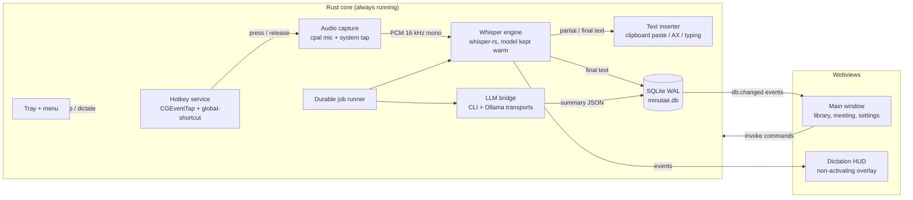
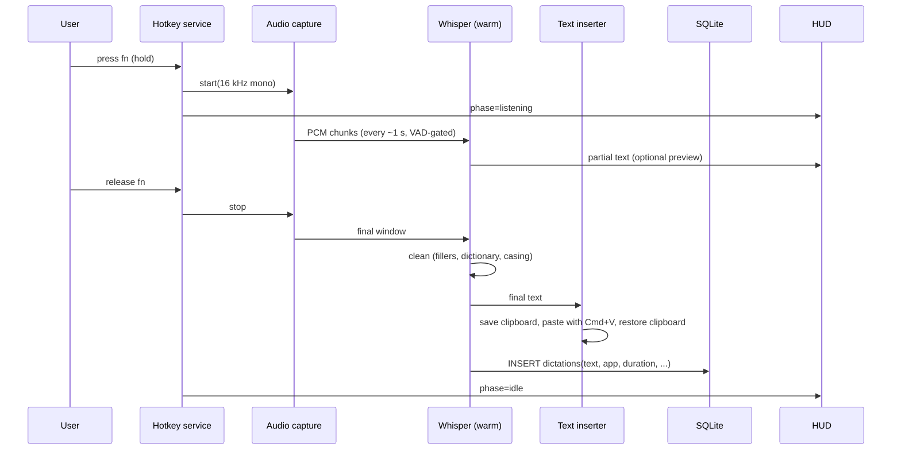
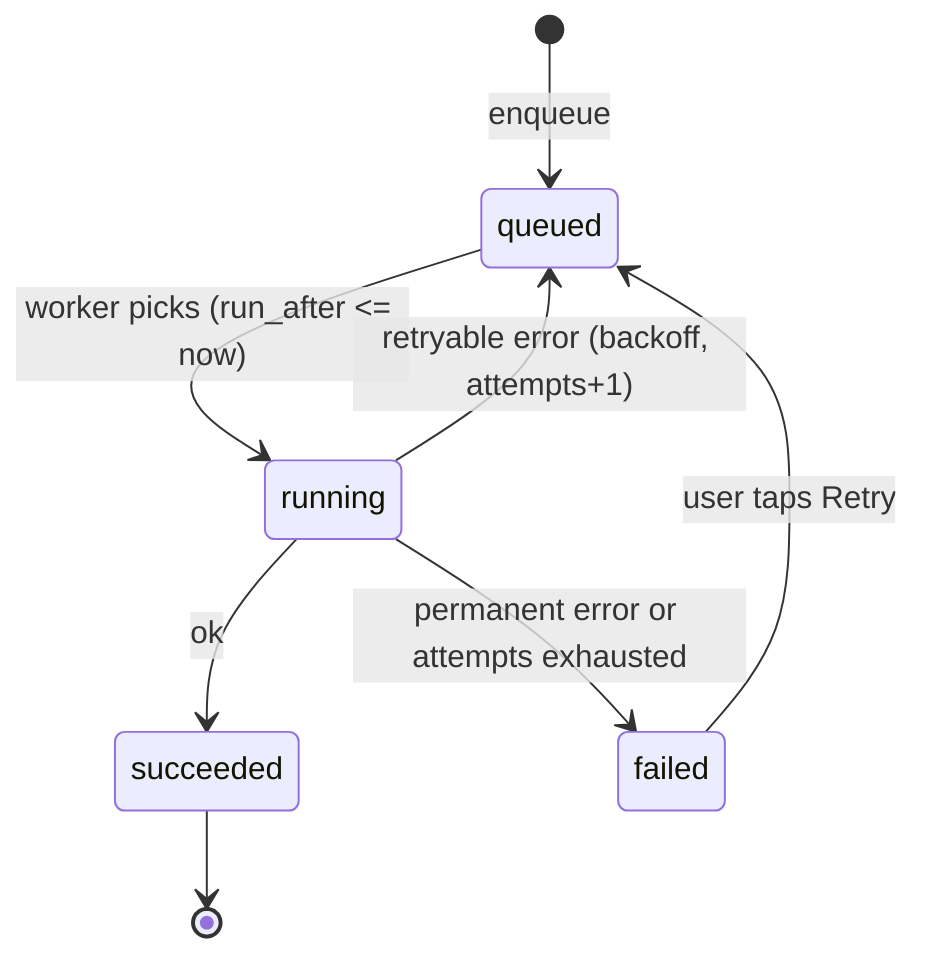

# Minutae — Target Architecture (v2)

Status: approved direction, ready for implementation · Written 2026-11-12 · Companion: [`TASKS.md`](./TASKS.md)

**Ownership.** The owner and the design/architecture agent own all design work: UI design in Paper, this architecture, and code review. The implementing agent owns implementation only. If implementation needs a design or architecture decision that is not here, stop and ask; do not invent one.

**Decisions locked on 2026-11-12:** dictation hotkey default is hold `⌥Space`; dictation audio is **kept** by default; minimum macOS is **14.4**; subscription transports are **Claude, Codex, Grok, Cursor** (plus Gemini if the owner adds it later, and Ollama as the offline fallback); "locked in the app" means every dictation is **logged** in Minutae.

Three product goals drive this revision, in the owner's priority order:

1. **No API keys.** Summaries and "ask across meetings" run on the AI subscriptions the user already pays for, through the vendors' own installed CLIs, with Ollama as a fully offline fallback.
2. **System-wide dictation** (Wispr Flow style). In any app, hold a hotkey, speak, and clean text appears at the cursor. Every dictation is also logged in Minutae.
3. **Proper transcript management.** One library for meetings and dictations: search, edit, export, retention, re-transcribe.

The design baseline is the Paper file "Xenial horizon", page "Ink & signal" (13 screens, light riso theme). Dark mode is deferred.

---

## 1. What exists today (verified in the repo)

| Area | State | Problem for the new goals |
|---|---|---|
| Shell | Tauri 2, one `main` window, no tray, no global shortcut plugin | Dictation needs to work with the window hidden |
| Recording | Webview `MediaRecorder` → WAV (`src/lib/audio/wav.ts`) | Webviews are throttled when hidden; not usable for background dictation |
| Transcription | `src-tauri/src/models/whisper.rs` shells out to a `whisper.cpp` binary per clip | Cold-starts the model every time; too slow for dictation |
| Summaries | `src/lib/providers/summary.ts`, API-key providers (Gemini, Claude, OpenAI, OpenRouter) | Requires keys; keys are not in the keychain |
| Dictation | `useDictation.ts`, history in `localStorage`, only inside the app window | Not system-wide, not durable, not searchable |
| DB | SQLite, Drizzle schema, migrations run from Rust (`db/init.rs`), reads/writes from the webview via `tauri-plugin-sql` | Rust cannot currently persist anything itself |
| Jobs | In-memory sequential queue in Zustand stores | Lost on quit/crash (audit finding) |

---

## 2. Principles (unchanged, plus three)

Local-first · Open and hackable (`.md` outputs) · Providers are interfaces · Offline capable · Small binary.

New:

- **Rust owns anything that must run while the window is hidden**: hotkeys, audio capture, dictation state machine, whisper, text insertion, CLI bridge, tray. The webview is a *view* of that state.
- **Never touch another app's credentials.** We invoke the vendor's official CLI as a subprocess. We never read their tokens, keychain items or config directories.
- **Fail visible.** Every background step has a persisted status and a user-facing reason.

---

## 3. System overview



Caption: The Rust core handles capture, transcription, insertion and the AI bridge; the webviews only display state and send commands.

### 3.1 Windows

| Window | Purpose | Notes |
|---|---|---|
| `main` | Library, meeting detail, settings | Closing it **hides** it (app stays alive in the tray). Keep the webview alive so UI state survives. |
| `hud` | Dictation overlay: waveform, state, last words | Transparent, borderless, always-on-top, all Spaces, click-through, **must not take focus** (use an NSPanel-style non-activating window; evaluate `tauri-nspanel`). Needs `macOSPrivateApi` for transparency. |
| `prompt` (optional) | "Looks like a meeting" card | Today it renders inside `main`; make it its own small window so it shows even when `main` is hidden. |

### 3.2 State ownership

| State | Owner | Consumers |
|---|---|---|
| Dictation phase (`idle / listening / transcribing / inserting / error`) | Rust state machine | HUD, tray icon, main window (events) |
| Meeting recording phase | Rust (moves from `useRecordingStore`) | tray, pill, main window |
| Library data | SQLite | Main window reads via `tauri-plugin-sql`; Rust writes via `rusqlite` (WAL, `busy_timeout`). Rust emits `db:changed {table, id}` so the UI refetches. |
| Settings | SQLite `settings` table | both |
| Secrets (optional API keys only) | macOS Keychain via the `keyring` crate | Rust only; the webview never sees them |

---

## 4. Subsystem: Subscription-backed AI ("LLM bridge")

### 4.1 Decision record

**Need:** call a strong LLM for summaries, action items, "ask across meetings" and optional dictation clean-up, using the user's existing subscriptions instead of API keys.

| Option | Verdict |
|---|---|
| **A. Spawn the official vendor CLI headlessly** (`claude`, `codex`, Grok's CLI, Cursor's `cursor-agent`; Gemini optional) from Rust and parse its output | **Chosen.** Uses the vendor's own auth, small footprint, works with whatever the user has logged into. The owner has Claude, Codex, Grok and Cursor subscriptions. Grok and Cursor CLIs were not inspected yet: `LLM-01` must confirm they exist, run headlessly and allow it. |
| B. Claude Agent SDK / vendor SDK in a Node sidecar | Rejected for v1: ships a Node runtime inside a 10 MB app and still shells out to the same CLI underneath. |
| C. Read OAuth tokens from the CLI's keychain/config and call the vendor API directly | **Forbidden.** Violates vendor terms and is fragile. Do not implement. |
| D. Local models via Ollama (`localhost:11434`) | **Included** as the guaranteed offline/free transport and the fallback. |
| E. Keep API keys | Kept as an *advanced* transport, off by default, keys in Keychain. |

> **Compliance caveat (owner should read).** Driving a consumer subscription from a third-party app is a grey area, and vendor rules and rate limits change. Our design stays on the safe side of the line by only running the user's own installed, logged-in CLI on their own machine, one request at a time, for their own data. Task `LLM-01` includes re-reading each vendor's current terms and recording the result in `docs/llm-providers.md`. If a vendor forbids it, that transport ships disabled, and Ollama remains.

### 4.2 Interface

```ts
// src/lib/llm/types.ts  (frontend contract; execution happens in Rust)
type TransportId = 'claude-cli' | 'codex-cli' | 'grok-cli' | 'cursor-cli' | 'gemini-cli' | 'ollama' | 'api'

interface LlmRequest {
  system?: string
  prompt: string                // transcript chunks etc.
  json?: ZodSchema              // when set, output is validated; one repair retry
  maxOutputTokens?: number
  timeoutMs?: number            // default 120_000
  signal?: AbortSignal          // cancels the subprocess
}
interface LlmResult { text: string; json?: unknown; transport: TransportId; model?: string; durationMs: number }

interface LlmTransport {
  id: TransportId
  detect(): Promise<{ installed: boolean; version?: string; loggedIn?: boolean; path?: string; hint?: string }>
  complete(req: LlmRequest): Promise<LlmResult>
}
```

`SummaryProvider` (existing interface) becomes a thin adapter over `LlmTransport`, so the rest of the app is unchanged. A **router** picks the transport from settings with an ordered fallback chain, e.g. `claude-cli → ollama`.

### 4.3 Rust execution rules (all transports that spawn a process)

1. **Resolve the binary robustly.** GUI apps launched from Finder do not inherit the shell `PATH`. Resolve once via `zsh -lic 'command -v <bin>'`, then fall back to `/opt/homebrew/bin`, `/usr/local/bin`, `~/.local/bin`, npm global bin. Cache the path; re-detect on failure. Note: on the owner's machine `claude` is a **shell function** that adds `--allow-dangerously-skip-permissions`. We must call the real binary, never that wrapper, and never pass any permission-skipping flag.
2. **Text-in, text-out only.** Run with tools disabled, no session persistence, in an empty temp working directory, so the model cannot read the repo or the filesystem. Exact flags per CLI are **candidates to verify** against the installed `--help` in `LLM-01`: for example `claude -p --output-format json`, `codex exec --sandbox read-only --skip-git-repo-check --output-last-message <file>`, `gemini -p --output-format json`.
3. **Prompt over stdin or a temp file, not argv**, so transcripts do not appear in `ps` output.
4. **Timeout, cancellation, concurrency cap** (default 1 in flight per transport), and kill the whole process group on abort.
5. **Classify failures**: not installed, not logged in (surface "Run `claude login` in Terminal"), rate-limited / quota (back off and surface the reset time if the CLI reports it), timeout, malformed output. These map to the job `error_code` and to UI copy.
6. **Structured output**: ask for JSON, strip code fences, validate with Zod, one automatic repair retry with the validation error appended, then fail with `invalid_output`.
7. **Long transcripts**: if the transcript exceeds the model's budget, map-reduce (chunk summaries → merge). The chunker lives in TS (`src/lib/prompts/`), the bridge stays dumb.
8. **Privacy label in the UI**: "Transcript text is sent to <vendor> through your signed-in CLI. Audio never leaves this Mac." Ollama shows "Stays on this Mac".

### 4.4 Usage accounting

Subscriptions have no per-token dollar cost. `api_usage_log` gains `transport`, `duration_ms`, `ok`, `error_code`, and `est_tokens_in/out` (character count ÷ 4). The **Usage page's "AI spend" card becomes "AI calls"** (count, success rate, average time) and shows dollars only when the `api` transport was used. This is a design change; see task `DS-03`.

---

## 5. Subsystem: System-wide dictation

### 5.1 Experience

- **Hold-to-talk** (default): hold the hotkey, speak, release → text appears at the cursor.
- **Tap-to-toggle / hands-free**: double-tap the hotkey to start, tap again to stop.
- **Cancel**: `Esc` while listening discards the clip.
- A small HUD near the bottom of the active screen shows the waveform and state. It never steals focus.
- Every successful dictation is saved to the library (`dictations` table) with the target app.

Default hotkey: **hold `⌥Space`**, registered with `tauri-plugin-global-shortcut`, which reports press and release and needs **no Input Monitoring permission**. `fn` and other modifier-only keys cannot be registered that way and need a `CGEventTap`; support them as an **optional** advanced binding that asks for Input Monitoring only when the user selects it. Hotkey is configurable.

### 5.2 Pipeline



Caption: Press starts capture, release finalises transcription, and the text is inserted and logged.

### 5.3 Components

| Component | Choice | Notes |
|---|---|---|
| Hotkey | `tauri-plugin-global-shortcut` for chords (default `⌥Space`); optional `CGEventTap` (listen-only, `core-graphics` crate) for modifier-only keys such as `fn` | The tap needs **Input Monitoring** and is only enabled if the user picks a modifier-only key. Debounce; "tap vs hold" threshold default 250 ms. |
| Capture | `cpal` in Rust, 16 kHz mono f32, ring buffer | Replaces `MediaRecorder` for dictation. Meeting capture can migrate later. Pre-roll buffer of ~300 ms so the first word is not clipped. |
| VAD | Energy gate + a small VAD (e.g. webrtc-vad or whisper.cpp's built-in VAD) | Skips silence, ends the clip on release. |
| ASR | `whisper-rs` (whisper.cpp bindings) with the `metal` feature, **model loaded once and kept warm** | Target: ≤ 1.5 s from release to text for a 10 s clip on `small` on Apple Silicon. Replaces per-clip process spawn for dictation; keep the binary path as a fallback. Model files stay in `~/Library/Minutae/models/`. |
| Clean-up | Local rules: strip `[BLANK_AUDIO]`-style tags, filler words, custom dictionary and snippet replacements, sentence casing | Optional LLM polish is **off by default** (adds seconds). |
| Insertion | 1) clipboard + synthetic `Cmd+V`, restoring *all* pasteboard types after ~300 ms; 2) Accessibility API `AXSelectedText` set; 3) per-character CGEvent typing for paste-hostile apps | Needs **Accessibility** permission. **Refuse to insert into secure fields**: check `IsSecureEventInputEnabled()` and skip with a HUD message. |
| Target app | `NSWorkspace.frontmostApplication` captured at key-down | Stored on the dictation row (bundle id and name). |
| HUD | Second Tauri window, see 3.1 | Events: `dictation:phase`, `dictation:level`, `dictation:partial`, `dictation:result`, `dictation:error`. |

### 5.4 Conflicts to handle

- Dictation while a **meeting is recording**: allowed. The mic stream is shared; dictation takes a copy of the PCM ring and does not stop the meeting. (Today it is blocked; remove that restriction.)
- Dictation while the model is missing or downloading: HUD shows "Model not ready", with a link to Settings.
- Mic busy / permission denied: surface the specific macOS state, not a generic error.

---

## 6. Subsystem: Transcript and library management

### 6.1 Data model changes

Existing tables stay. New or changed:

```
dictations(id, text, raw_text, app_bundle_id, app_name, duration_ms, model, language,
           audio_path NULL, inserted INTEGER, created_at, deleted_at NULL)
jobs(id, kind, subject_type, subject_id, status, attempts, error_code, error_message,
     payload_json, created_at, updated_at, run_after)          -- durable queue
tags(id, name) ; item_tags(item_type, item_id, tag_id)
transcript_edits(id, transcript_id, segment_id, old_text, new_text, edited_at)   -- optional, for undo
dictionary(id, phrase, replacement, kind)                      -- custom words and snippets
settings            -- add keys: dictationHotkey, dictationMode, insertMethod, keepDictationAudio,
                    --   llmTransportOrder, llmModelOverrides, audioRetentionDays
api_usage_log       -- add: transport, duration_ms, ok, error_code, est_tokens_in, est_tokens_out
```

FTS5 virtual tables already cover transcripts; add one for `dictations.text`. `localStorage` dictation history is migrated into `dictations` once, then deleted.

### 6.2 Capabilities

| Capability | Behaviour |
|---|---|
| Unified library | One list of meetings and dictations, filter by kind, app, tag, date, status. Dictations show their target app. |
| Search | FTS5 keyword plus the existing local embeddings. ⌘K opens it; "Ask across meetings" uses the LLM bridge with the top-k chunks as context and returns citations (meeting id + timestamp). |
| Edit | Edit transcript text and speaker names inline; edits persist and flow into regenerated summaries. |
| Re-run | Re-transcribe with another model; re-summarise with another provider. Previous version is kept until the new one succeeds. |
| Export | Markdown (existing format), plain text, SRT/VTT, JSON. Bulk export. |
| Retention | **Dictation audio is kept by default** (owner decision) so a dictation can be replayed and re-transcribed with a better model; store as 16 kHz mono WAV now (about 2 MB per minute), compress later if size matters. Per-kind auto-delete after N days is a setting, default "never". Transcripts and summaries always stay. "Free up space" shows disk use by type and offers to purge audio only. Privacy copy must say "Audio is kept on this Mac". |
| Delete | Soft delete with undo toast, then hard delete incl. audio and `.md` file. |
| Resilience | Everything long-running is a row in `jobs`; on launch, unfinished jobs resume; failures show a retry block (matches the Paper design). |

### 6.3 Job flow (durable)



Caption: Jobs survive restarts; only retryable errors are retried automatically.

Job kinds: `transcribe`, `summarize`, `embed`, `export`. Meeting pipeline: `transcribe → summarize → embed`, each its own job so a failed summary does not redo transcription.

---

## 7. Meeting pipeline upgrades (carried from the audit)

| Feature | Approach |
|---|---|
| **You vs Them** | Capture system audio in a second track with Core Audio process taps (**minimum macOS 14.4**, `NSAudioCaptureUsageDescription`); no ScreenCaptureKit fallback. Two-channel WAV; transcribe each channel; label *You* (mic) and *Them* (system). A short Swift helper sidecar is acceptable if the Rust bindings prove painful. Spike first (`MTG-01`). |
| Calendar-aware detection | EventKit read access; match a running mic session to the nearest event to name the meeting and pre-fill participants. |
| Live notes | Notes pane with `Cmd+Enter` = mark as action item; notes are passed to the summary prompt. Live transcript shown from chunked whisper on the system+mic mix. |
| Tray | Template-image icon (monochrome, 18 pt) in the menu bar, red-dot variant while recording. Menu: pause/stop, Open, Dictate, pause detection, up next. |
| Atomic stop | Stopping a meeting writes the file, the DB rows and enqueues jobs in one transaction (audit finding). |

---

## 8. Security and privacy checklist

- Strict CSP in `tauri.conf.json` (currently permissive); no remote script.
- Optional API keys only in Keychain (`keyring`); the webview never receives them.
- Subprocess prompts via stdin/temp file, temp dir `0700`, deleted afterwards.
- Model name and path inputs sanitised before use in file paths or commands (audit finding).
- Sanitise search excerpts; remove `dangerouslySetInnerHTML` (audit finding).
- Never log transcripts at info level; debug logs are opt-in.
- Permissions requested just-in-time with a plain-language reason; each degrades gracefully if denied.

macOS permissions map:

| Feature | Permission | Info.plist key / mechanism |
|---|---|---|
| Mic capture | Microphone | `NSMicrophoneUsageDescription` |
| `⌥Space` and other chords | none | n/a |
| Optional `fn` / modifier-only hotkey | Input Monitoring | system prompt on first tap, only if enabled |
| Paste into other apps | Accessibility | `AXIsProcessTrustedWithOptions` |
| System audio | Audio capture / Screen recording (fallback) | `NSAudioCaptureUsageDescription` |
| Calendar | Calendars | `NSCalendarsUsageDescription` |

---

## 9. Module layout (target)

```
src-tauri/src/
  hotkey/        event_tap.rs  shortcut.rs  mod.rs
  audio/         capture.rs  ring.rs  vad.rs  mic_monitor.rs  system_tap.rs
  asr/           engine.rs (whisper-rs)  fallback_cli.rs  postprocess.rs
  dictation/     state.rs  inserter.rs  frontmost.rs  secure_input.rs
  llm/           mod.rs  detect.rs  runner.rs  claude.rs  codex.rs  gemini.rs  ollama.rs  api.rs
  jobs/          queue.rs  worker.rs
  db/            init.rs  repo.rs        # Rust-side writes (dictations, jobs, usage)
  tray.rs  windows.rs  permissions.rs
src/
  lib/llm/       types.ts  router.ts  summary-adapter.ts
  lib/library/   queries.ts  export.ts  retention.ts
  pages/         LibraryPage (Meetings + Dictations)  DictatePage  ...
  windows/hud/   Hud.tsx
```

Each lane registers its Tauri commands from its own module and adds **one line** to `lib.rs`, to avoid merge conflicts between parallel agents.

---

## 10. Non-functional targets

| Metric | Target |
|---|---|
| Dictation latency (release → text visible), 10 s clip, `small`, Apple Silicon | ≤ 1.5 s p50, ≤ 3 s p95 |
| Hotkey press → HUD "listening" | ≤ 150 ms |
| Idle CPU with detection on | < 1% |
| Idle RAM (model resident) | < 700 MB with `small`, model unload after N idle minutes (setting) |
| Summary job for a 30 min meeting via CLI | completes or fails with a classified error within 3 min |
| Data loss on crash during recording | ≤ last 10 s (write audio incrementally) |
| Bundle size | < 25 MB excluding models |

---

## 11. Decisions (resolved 2026-11-12) and remaining unknowns

| # | Question | Decision |
|---|---|---|
| 1 | Meaning of "locked in the application" | Every dictation is logged in Minutae |
| 2 | Subscriptions | Claude, Codex, Grok, Cursor. This machine also has `gemini` and `ollama` installed; `claude` is a shell function. |
| 3 | Default hotkey | Hold `⌥Space`; `fn` optional |
| 4 | Keep dictation audio | Yes, by default |
| 5 | Minimum macOS | 14.4 |

Remaining unknowns, to be settled by `LLM-01`: whether Grok's and Cursor's CLIs exist in a form that runs headlessly, their exact flags, and whether their terms allow it. The `LLM-01` result decides which of the four ship.
