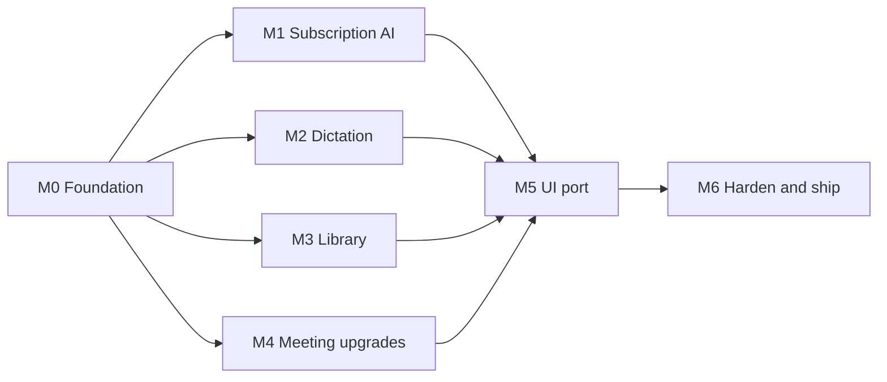

# Minutae v2 — Implementation Task List

For the implementing agent(s). Read [`ARCHITECTURE.md`](./ARCHITECTURE.md) first. Design source of truth: Paper file "Xenial horizon", page "Ink & signal".

Written 2026-11-12. Nothing here is implemented yet. Current branch has uncommitted redesign work; **commit or branch before starting** (see `FND-00`).

## Ownership (read this first)

| Work | Owner |
|---|---|
| UI design (Paper), architecture, design and code review | **Owner + design/architecture agent. Not yours.** |
| Implementation of everything below | **Implementing agent** |

- Tasks prefixed `DS-` are **design tasks owned by the design agent**. They are listed so you know what will be delivered and when. **Do not do them.** Wait for the design to be marked approved in the "Design status" table before starting any `UI-` task or UI part of a lane task.
- If something needs a design or architecture decision that is not in `ARCHITECTURE.md`, stop and write the question in the PR description or hand it back. Do not invent UI or change the architecture.
- Your PRs get reviewed by the design/architecture agent against the acceptance criteria. Keep PRs to one task ID each.

Decisions already locked (do not reopen): default hotkey hold `⌥Space` (`fn` optional); dictation audio kept by default; minimum macOS 14.4; providers Claude, Codex, Grok, Cursor (+ Gemini optional, Ollama fallback); every dictation is logged.

### Design status (maintained by the design agent)

| ID | Screen / topic | Status |
|---|---|---|
| DS-01 | Popup style: soft shadows | in progress |
| DS-02 | Menu-bar icon | in progress |
| DS-03 | Settings and Usage for subscription AI, dictation settings | queued |
| DS-04 | Library, transcript editor, export, storage, HUD, dictionary | queued |
| Approved already | 01–13 in Paper (Meetings, Audio, Detected, Recording, Summary, Transcript, Dictate, Search, Settings, Usage, Onboarding, Live notes, Menu bar) apart from the DS-01/02 corrections | approved by owner |

## How to use this list

- Task IDs are stable. `Deps` lists IDs that must be merged first.
- Size: **S** ≤ half a day · **M** ~1 day · **L** 2–3 days · **XL** spike or > 3 days (split it).
- Every task has **Acceptance criteria**; a task is done only when all are met, `pnpm typecheck` and `pnpm lint` pass, and for Rust `cargo check` + `cargo clippy` are clean.
- Parallel lanes: `LLM`, `DIC`, `LIB`, `MTG` can run at the same time after `FND`. Each lane adds Tauri commands in its **own module** and one registration line in `src-tauri/src/lib.rs`.
- Add tests with each task (Phase 10 of `PLAN.md` was never done). Rust: `#[cfg(test)]` unit tests for parsers and state machines. TS: Vitest for pure logic.
- Do not read, copy or export credentials of any external CLI or app. See Architecture §4.1.

## Milestones

Caption: After the foundation, four lanes run in parallel and converge on the UI port, then hardening.

| Milestone | Outcome the owner can see |
|---|---|
| M0 | Clean base, durable jobs, Rust can write to the DB, design fixes made |
| M1 | Summaries generated through the user's Claude/Codex/Gemini CLI or Ollama, no API key anywhere |
| M2 | Hold a key in any app, speak, text appears; entry appears in Minutae |
| M3 | Unified, searchable, editable, exportable library with retention |
| M4 | You/Them split, calendar names, live notes, tray |
| M5 | App matches the Paper design |
| M6 | Tests, signing, release |

---

## M0 — Foundation and design fixes

> The four `DS-` tasks below are **design-agent work, not for the implementer**.

### DS-01 · Fix popup styling in Paper (neo-brutalism out) · S
Owner feedback: the hard 2px ink border and 6px offset shadow on popups is disliked.
- Artboards: 03 Meeting detected (prompt card), 08 Search & ask (modal), 13 Menu bar (tray menu).
- Replace with: 1px `--c-line` border, 16–20px radius, soft layered shadow (e.g. `0 12px 40px rgba(27,26,23,.18), 0 2px 6px rgba(27,26,23,.08)`). Keep pastel fills and pill buttons.
- Record the final shadow and radius as tokens (`--shadow-pop`, `--r-lg`).
**Acceptance:** all three artboards updated; owner approves a screenshot; tokens added to the Paper token set.

### DS-02 · Fix menu-bar icon placement and style in Paper · S
Owner feedback: icon placement on the menu bar is off.
- Draw the status item where macOS puts it (right cluster, left of Control Center/clock, 22 pt slot), as a **monochrome template glyph** (the 4-bar mark), with a separate red-dot variant for recording.
- Menu panel hangs from the icon, aligned to its x-centre, with standard 6 px gap.
**Acceptance:** artboard 13 shows idle and recording icons side by side at 1× and 2×; owner approves.

### DS-03 · Update Usage and Settings designs for subscription AI · M
Deps: none (design may proceed alongside M1).
- Usage: "AI spend $" card becomes "AI calls" (count, success rate, avg time) with a per-provider breakdown; show $ only for the API transport.
- Settings → Summaries: replace Provider + API key with **Provider cards** (Claude, ChatGPT/Codex, Gemini, Ollama) each showing status (Installed / Signed in / Not found), a **Test** button, fallback order drag-handle, privacy label ("Sent to X via your CLI" / "Stays on this Mac"). Move "Use API key instead" into an Advanced disclosure.
- Settings → Dictation section: hotkey picker (hold / toggle), insert method, "Keep audio" toggle, dictionary link, permission status rows (Input Monitoring, Accessibility, Microphone).
**Acceptance:** screens updated in Paper and approved by owner.

### DS-04 · Design the Library and transcript-management screens · L
New screens: unified Library (Meetings + Dictations tabs/filters, bulk select), Dictation detail (raw vs cleaned text, app, copy, re-insert), Transcript editor (inline edit, speaker rename), Export sheet, Storage & retention page, Dictation HUD (listening / transcribing / error states), Dictionary & snippets editor.
**Acceptance:** each screen drawn in the riso theme with empty, loading and error states; approved by owner.

### FND-00 · Baseline the repository · S
- Review the uncommitted redesign changes, split into logical commits on `audit/stack-redesign-2026-11`, open a PR into `main`.
**Acceptance:** working tree clean; CI (typecheck, lint, `cargo check`) green.

### FND-01 · Rust-side database access · M
Deps: FND-00.
- Add `rusqlite` (bundled) or `sqlx`; open the same `~/Library/Minutae/minutae.db` in WAL mode with `busy_timeout=5000`; set the same pragmas from the webview connection.
- Create `db/repo.rs` with typed insert/update helpers needed later (dictations, jobs, usage log).
- Emit `db:changed {table, id}` events after writes.
**Acceptance:** a Rust test inserts a row while the webview holds a read connection with no `SQLITE_BUSY`; a TS listener refetches on `db:changed`.

### FND-02 · Schema migration v2 · M
Deps: FND-01.
- Add the tables and columns in Architecture §6.1 (`dictations`, `jobs`, `tags`, `item_tags`, `dictionary`, usage-log columns, FTS5 for dictations, new settings keys) as a new Drizzle migration; keep the Rust migration runner in `db/init.rs` as the single applier.
- Update `src/lib/db/schema.ts` and repos; add repos `dictations.ts`, `jobs.ts`, `dictionary.ts`.
**Acceptance:** fresh install and upgrade-from-existing-DB both reach the new version; existing meetings unaffected (migration test with a seeded old DB).

### FND-03 · Durable job runner · L
Deps: FND-02.
- Implement `jobs/queue.rs` + `worker.rs` per Architecture §6.3: enqueue, claim (single worker per kind), retry with exponential backoff for retryable codes, resume unfinished jobs at launch, cancel.
- Expose commands `job_enqueue`, `job_list`, `job_retry`, `job_cancel`; emit `job:updated`.
- Job kinds `transcribe`, `summarize`, `embed`, each delegating to a handler registry (handlers implemented in other lanes; stub them now).
- Replace in-memory queues in `src/store/transcription.ts` and `src/store/summary.ts` with job-backed state.
- Make "stop meeting" atomic: file write + DB rows + job enqueue in one transaction (audit fix).
**Acceptance:** kill the app mid-summarise; on relaunch the job resumes. Retry block in UI works. Unit tests for backoff and claim logic.

### FND-04 · Window and tray scaffolding · M
Deps: FND-00.
- `main` hides on close instead of quitting; app stays running; Dock/tray reopen it.
- Add `hud` window (transparent, borderless, always-on-top, all Spaces, click-through, no focus). Evaluate `tauri-nspanel` for non-activating behaviour; document the decision.
- Add `tray.rs` with a template-image icon, idle/recording variants, and a menu (static items for now).
- Enable `macOSPrivateApi` as needed; update capabilities for the `hud` window.
**Acceptance:** with `main` hidden, the tray icon shows; the HUD can be shown over a full-screen app without stealing focus (manual test with typing in TextEdit while the HUD is visible).

### FND-05 · Permissions service · M
Deps: FND-04.
- `permissions.rs`: query and request Microphone, Accessibility (`AXIsProcessTrustedWithOptions`), Input Monitoring (`CGPreflightListenEventAccess` / `CGRequestListenEventAccess`), Calendar (later), Audio capture (later).
- Commands `permissions_status`, `permissions_request(kind)`, `permissions_open_settings(kind)`; event on change (poll every 2 s while Settings or Onboarding is open).
- Add all Info.plist usage strings (see Architecture §8) via `src-tauri/Info.plist`.
**Acceptance:** each permission shows correct state before/after granting without restarting the app.

### FND-06 · Keychain for optional API keys, CSP, input hardening · M
Deps: none.
- Move any existing API keys from the `settings` table to Keychain (`keyring`), with a one-time migration that deletes the DB copies. Webview gets only "has key" booleans.
- Tighten CSP in `tauri.conf.json`; remove `dangerouslySetInnerHTML` from search excerpts; sanitise whisper model names and all path inputs; fix embedder `_loading` unstick; resync mic monitor after stop (audit items).
**Acceptance:** no secret appears in the SQLite file (grep test); CSP blocks an injected remote script in a test; search excerpts render safely with `<script>` in a transcript.

---

## M1 — Subscription-backed AI (no API keys)

Highest owner priority. Start right after `FND-02`; does not need `FND-03` to begin.

### LLM-01 · Provider research and compliance note · S
Deps: none. Do this **first**.
- For each of **Claude Code, OpenAI Codex CLI, Grok's CLI, Cursor's CLI (`cursor-agent`)**, plus Gemini CLI and Ollama as extras: on this machine run `--version` and `--help`, and read the vendor's current usage terms for automated/headless use of a subscription login. Grok and Cursor were **not inspected yet**: first confirm each has an official CLI, how it is installed and how it logs in; if there is none, mark it "unavailable" and move on.
- Determine the exact non-interactive flags to (a) disable tools, (b) avoid session persistence, (c) emit JSON, (d) pick a model, (e) read the prompt from stdin or a file. Capture real sample outputs including **error outputs** (logged out, rate limit).
- Write `docs/llm-providers.md` with the findings and a go/no-go per provider.
**Acceptance:** doc contains verified commands, sample stdout/stderr, and a clear terms verdict per provider. The owner reviews before `LLM-03+` ship any provider marked "no-go".

### LLM-02 · Transport interface and subprocess runner · L
Deps: FND-00, LLM-01.
- `src-tauri/src/llm/runner.rs`: spawn with env scrub (keep `HOME`, `PATH`, locale; drop unrelated secrets), empty temp cwd (`0700`), stdin prompt, stdout/stderr capture with size caps, timeout, abort, process-group kill, single-flight per transport.
- `detect.rs`: binary resolution via login shell + known paths, `--version` probe, login-state probe (a cheap `hello` call, rate-limited and cached 60 s).
- Commands: `llm_detect`, `llm_complete(req)`, `llm_cancel(id)`; stream partial output as `llm:chunk` events for long jobs.
- Failure taxonomy enum shared with TS: `not_installed | not_logged_in | rate_limited | timeout | cancelled | invalid_output | unknown`.
**Acceptance:** unit tests with a fake CLI script (shell script fixtures) cover success, non-zero exit, timeout, abort, oversized output, and the failure classifications. No transcript text appears in `ps` while a call runs (manual check).

### LLM-03 · Claude CLI transport · M
Deps: LLM-02.
- `claude.rs` using flags verified in `LLM-01`. Must call the **real binary**, never the user's shell-function wrapper, and never pass permission-skipping flags.
- Parse JSON result (`result`, usage/cost fields if present), map errors.
**Acceptance:** integration test (opt-in via `MINUTAE_LLM_E2E=1`) returns a valid summary JSON for a fixture transcript; "Test" in Settings reports state correctly when logged out.

### LLM-04 · Codex CLI transport · M
Deps: LLM-02. Same shape as `LLM-03` for `codex exec` (read-only sandbox, `--skip-git-repo-check`, last-message output file).

### LLM-05 · Grok, Cursor and Gemini transports · M each
Deps: LLM-02, LLM-01 verdict. Same shape as `LLM-03`, one transport per provider (`grok-cli`, `cursor-cli`, optional `gemini-cli`). Skip any provider `LLM-01` marked "unavailable" or "no-go" and note it in the PR.

### LLM-06 · Ollama transport · M
Deps: LLM-02.
- HTTP to `localhost:11434` (`/api/chat`, streaming off for JSON mode, `format: "json"`), model list from `/api/tags`, "pull model" helper that shows progress.
- Recommended default model list in the UI (small, mid, large) with RAM guidance.
**Acceptance:** works fully offline; clear message if Ollama is not running with a "Start Ollama" hint.

### LLM-07 · Router, fallback chain, TS SDK · L
Deps: LLM-02 (+ at least one transport).
- `src/lib/llm/` per Architecture §4.2: `LlmTransport`, router with ordered fallback, per-feature model override (summary, ask, dictation polish), JSON validation + single repair retry, map-reduce chunking for long transcripts (`src/lib/prompts/`).
- Adapt `SummaryProvider` to the router; delete direct API-key providers from the default path but keep an `api` transport behind Advanced.
- Settings keys: `llmTransportOrder`, `llmModelOverrides`.
**Acceptance:** with `claude-cli` forced to fail, the router falls back to `ollama` and the summary still completes; failures surface as classified job errors with UI copy; Vitest covers router, repair retry and chunking.

### LLM-08 · Usage accounting for subscription calls · S
Deps: LLM-07, FND-02.
- Log every call to `api_usage_log` with `transport`, `duration_ms`, `ok`, `error_code`, estimated tokens. Update Usage queries for the "AI calls" card (see `DS-03`).
**Acceptance:** Usage page shows counts and success rate; $ shown only when the `api` transport was used.

### LLM-09 · Provider settings UI · M
Deps: LLM-07, DS-03.
- Provider cards, Test buttons, fallback order, privacy labels, Advanced → API key. Show actionable guidance for each failure code (e.g. "Open Terminal and run `claude login`").
**Acceptance:** matches the approved design; every failure code has copy and a retry path.

---

## M2 — System-wide dictation

### DIC-01 · Spike: optional `fn` / modifier-only hotkey · S
Deps: FND-05. Lower priority than before: the default is the chord `⌥Space`, which needs no extra permission.
- Prove a listen-only `CGEventTap` detects `fn` and Right ⌥ with correct press/release without swallowing keys; measure latency; document behaviour when Input Monitoring is denied.
**Acceptance:** short write-up and prototype branch. Not blocking `DIC-02`.

### DIC-02 · Hotkey service · L
Deps: FND-04.
- `hotkey/shortcut.rs` using `tauri-plugin-global-shortcut` with **press and release** events; default **hold `⌥Space`**; hold-to-talk, double-tap toggle (hands-free), `Esc` cancel; thresholds configurable; live re-binding when settings change; conflict detection with a clear error when another app owns the chord.
- `hotkey/event_tap.rs` behind the same trait for modifier-only keys, **only built into the active path if `DIC-01` succeeded and the user selects such a key**. Re-enable the tap after system timeouts and wake.
**Acceptance:** works in Safari, VS Code, Slack, Terminal, Notes; no stuck-key states after sleep/wake; unit tests for the hold/tap state machine.

### DIC-03 · Rust audio capture for dictation · L
Deps: FND-04.
- `audio/capture.rs` with `cpal`: select input device (default + user choice), 16 kHz mono f32 via resampler, ring buffer with ~300 ms pre-roll, level meter events (≈20 Hz) for the HUD, handles device change/unplug.
- Allow sharing the mic stream with an active meeting recording (no stop/start).
**Acceptance:** HUD level meter responds; first word not clipped in a 20-trial test; unplugging the mic mid-clip yields a clean error.

### DIC-04 · Warm whisper engine · L
Deps: FND-04.
- `asr/engine.rs` using `whisper-rs` with Metal; load model once on demand, keep resident, unload after a configurable idle time; `transcribe(pcm, opts) -> {text, segments, lang}`; language auto-detect or fixed; initial prompt from the user's dictionary.
- Keep `models/whisper.rs` binary path as a fallback and for meeting-length audio until migrated.
- Benchmarks recorded in `docs/benchmarks.md` for tiny/base/small on this Mac.
**Acceptance:** 10 s clip on `small` transcribes in ≤ 1.5 s median after warm-up; memory stays under the target in Architecture §10.

### DIC-05 · Post-processing and dictionary · M
Deps: DIC-04, FND-02.
- Strip whisper tags, filler words (configurable list), repeated words, normalise spacing/casing/punctuation; apply dictionary replacements and snippets (`dictionary` table), whole-word, case-aware.
- Optional LLM polish hook via `LLM-07` (off by default, shows latency warning).
**Acceptance:** table-driven unit tests with 30+ cases including punctuation and mixed-language input.

### DIC-06 · Text inserter · L
Deps: FND-05.
- `dictation/inserter.rs`: snapshot all pasteboard types and restore them after ~300 ms; synthetic `Cmd+V`; fallback to AX set-selected-text; fallback to per-character CGEvent typing.
- `secure_input.rs`: if `IsSecureEventInputEnabled()` or the focused element is a secure text field, do **not** insert; copy to clipboard instead and tell the user in the HUD.
- `frontmost.rs`: capture frontmost app bundle id and name at key-down.
**Acceptance:** inserts correctly in Notes, Safari text areas, VS Code, Slack, Terminal; clipboard contents (including images and files) are restored; password fields are refused. Unit tests for the decision logic.

### DIC-07 · Dictation state machine and persistence · M
Deps: DIC-02, DIC-03, DIC-04, DIC-05, DIC-06, FND-01, FND-02.
- Single Rust state machine: `idle → listening → transcribing → inserting → idle | error`; emits `dictation:*` events; writes a `dictations` row on completion (text, raw_text, app, duration, model, inserted flag).
- **Audio is kept by default** (owner decision): save each clip as 16 kHz mono WAV under `~/Library/Minutae/dictations/YYYY-MM/`, store `audio_path`, and keep it unless the user sets auto-delete. Provide "Re-transcribe" using the stored clip (see `LIB-06`).
- Minimum clip length and silence guard (ignore < 300 ms or all-silence clips with a HUD hint).
- Migrate `localStorage` history into `dictations` once.
**Acceptance:** end-to-end manual script passes in 5 apps; every dictation is visible in the Library with the correct app name; zero rows for cancelled clips.

### DIC-08 · Dictation HUD window · M
Deps: DIC-07, DS-04.
- `src/windows/hud/Hud.tsx` per approved design: listening waveform (butter on ink pill), transcribing spinner, error/"model not ready"/"secure field" states, auto-hide. Positions near the bottom centre of the screen holding the active window.
**Acceptance:** HUD never steals focus or alters the frontmost app; visible over full-screen apps and on all Spaces.

### DIC-09 · Dictation settings and Dictate page · M
Deps: DIC-07, DS-03.
- Settings per `DS-03`; Dictate page rewritten to read from `dictations` (copy, re-insert, delete, search). Test button that dictates into a sandbox field.
- Guided permission flow when Input Monitoring or Accessibility is missing.
**Acceptance:** changing the hotkey takes effect immediately without restart; denied permissions show the specific fix.

---

## M3 — Transcript and library management

### LIB-01 · Library data layer · M
Deps: FND-02.
- Repos and queries for a unified list (meetings + dictations) with filters (kind, app, tag, date range, status), sorting, pagination, FTS5 search and the existing embedding search merged and ranked.
**Acceptance:** 10 000-row seeded DB returns a filtered page in < 100 ms; Vitest covers query builders.

### LIB-02 · Library UI · L
Deps: LIB-01, DS-04.
- Meetings page becomes Library with kind filter chips, bulk select, tag chips, status pills as designed. Dictations rows show target app.
**Acceptance:** matches the design; keyboard navigation works (↑↓, Enter, ⌘A, Delete).

### LIB-03 · Transcript editor · L
Deps: LIB-01, DS-04.
- Inline edit of segment text, speaker rename (global per meeting), find-and-replace, undo via `transcript_edits`.
- Edits mark the summary stale and offer "Regenerate summary".
**Acceptance:** edits persist across restart; undo works; FTS index and embeddings refresh after edits (enqueue `embed` job).

### LIB-04 · Export · M
Deps: LIB-01.
- Export one or many items as Markdown (existing format), TXT, SRT, VTT, JSON; "Export all" zip; "Reveal in Finder" and open-in-Obsidian-vault option (user-chosen folder, writes `.md` with frontmatter).
**Acceptance:** golden-file tests for each format; SRT/VTT timestamps validated against fixtures.

### LIB-05 · Retention and storage · M
Deps: FND-02.
- Settings: audio auto-delete after N days, separately for meetings and dictations, **default "never" for both** (dictation audio is kept by default), "Free up space" with per-type usage and an "Purge audio only" action that keeps transcripts, soft delete with Undo toast and a trash that purges after 14 days.
- A scheduled job runs daily and on launch.
**Acceptance:** test with a seeded DB proves only audio is purged while transcripts/summaries remain; hard delete removes audio, `.md` and DB rows.

### LIB-06 · Re-run and versioning · M
Deps: FND-03, LLM-07.
- Re-transcribe with another model; re-summarise with another provider. New output replaces the old only after success; keep the previous summary one version back.
**Acceptance:** failing re-run leaves the original intact and shows the retry block.

### LIB-07 · Ask across meetings · M
Deps: LLM-07, LIB-01.
- Retrieve top-k chunks via embeddings + FTS, build a cited prompt, call the router, render answer with citation chips linking to meeting + timestamp (Search modal design).
**Acceptance:** answers always include at least one citation or say "not found"; citations deep-link to the right transcript moment.

---

## M4 — Meeting pipeline upgrades

### MTG-01 · Spike: system audio capture · L
Deps: FND-05.
- Prototype Core Audio process taps (**macOS 14.4+ only**; set `LSMinimumSystemVersion` to 14.4; no ScreenCaptureKit fallback). Decide Rust bindings vs Swift helper sidecar. Record permission UX and failure modes (Bluetooth devices, sample-rate changes).
**Acceptance:** write-up with a recommendation and a prototype that records 2 min of Zoom/Meet audio to WAV.

### MTG-02 · Two-track recording and You/Them transcripts · XL (split after MTG-01)
Deps: MTG-01, DIC-03, FND-03.
- Record mic and system tracks; write incrementally (≤ 10 s loss on crash); transcribe per track; merge into one timeline with `speaker_label = You | Them`.
**Acceptance:** Transcript screen shows the You/Them split; summary prompt receives labelled speakers.

### MTG-03 · Calendar-aware detection · M
Deps: FND-05.
- EventKit read; when the mic activates, match the nearest event (±10 min) to name the meeting and prefill participants; show in the "Meeting detected" prompt.
**Acceptance:** works with Google and iCloud calendars synced to macOS Calendar; graceful when permission is denied.

### MTG-04 · Per-app detection and quieter prompts · M
Deps: DIC-03.
- Identify which app holds the mic (Zoom, Meet in browser, Teams, Slack Huddles); per-app "Never ask" list; suppress while dictating; debounce short mic uses.

### MTG-05 · Live notes pane · L
Deps: MTG-02, DS-04.
- Notes editor beside a live transcript, `⌘↵` marks a line as an action item, notes are passed into the summary prompt with `[note]` markers.
**Acceptance:** matches the Live notes design; notes persist if the app quits mid-meeting.

### MTG-06 · Tray menu behaviour · M
Deps: FND-04, DS-02.
- Live menu: pause/stop, Open, Dictate, pause detection (1 h / until tomorrow), Up next from the calendar, Quit. Icon switches to the recording variant.

### MTG-07 · Audio player and "how this was made" timeline · M
Deps: FND-03.
- Port the waveform scrubber, skip-silence, speed control and the timeline with retry block from the design into `MeetingDetailPage`, backed by `jobs` state.

---

## M5 — UI port of the Paper design

### UI-01 · Tokens, fonts, theme foundation · M
Deps: DS-01.
- Port tokens to `src/index.css` (`--c-bg … --c-peach`, radii, shadows from `DS-01`). Bundle **Fraunces**, **Geist**, **Geist Mono** locally (no CDN; offline app).
- Theme structure must allow adding a **dark palette later** by overriding the same variables under `[data-theme="dark"]` (dark variant is explicitly deferred, do not design one). Keep the Settings Appearance control wired to `System / Light`; show "Dark" as disabled "Coming soon" until then.
**Acceptance:** Tailwind v4 `@theme` exposes every token; no hard-coded hex remains in components (lint rule or grep check).

### UI-02 · Shell: sidebar, logo, nav, status pill · M
Deps: UI-01. Per artboards 01/07/09/10 (active item = butter pill).

### UI-03 · Pages · L each
Deps: UI-02 and the relevant lane tasks. One task per screen: Library (`LIB-02`), Meeting detail tabs Audio/Summary/Transcript, Dictate (`DIC-09`), Search & Ask (`LIB-07`), Usage (`LLM-08`), Settings (`LLM-09`, `DIC-09`, `LIB-05`), Onboarding (below).

### UI-04 · Onboarding and permissions flow · M
Deps: FND-05, DS-04.
- Three steps per artboard 11: privacy pitch, permissions (mic, system audio, calendar, accessibility, input monitoring), pick AI provider (detects installed CLIs, "Test" each) and download a whisper model.
**Acceptance:** first run on a clean user account completes without restarting; every permission can be skipped and revisited.

### UI-05 · Prompt card, recording pill, modals · S
Deps: UI-01, DS-01. Use the **soft-shadow** popup style, not the neo-brutalist one.

---

## M6 — Quality, packaging, release

### QA-01 · Test suites · L
Deps: ongoing.
- Vitest for TS libs; Rust unit tests per module; one Playwright/Tauri-driver smoke test (launch → onboarding skip → open library); a manual `docs/test-plan.md` for the OS-level features (hotkey, insertion, permissions) with a per-app matrix.

### QA-02 · Performance pass · M
- Verify every target in Architecture §10; fix regressions. Record results in `docs/benchmarks.md`.

### REL-01 · Entitlements, signing, notarisation, updater · L
- Hardened runtime entitlements for audio input; usage strings; Developer ID signing and notarisation in the GitHub Actions workflow; decide on Tauri updater.

### REL-02 · Docs and README · S
- README quick start (permissions, choosing an AI provider, dictation hotkey), `docs/llm-providers.md`, privacy statement, troubleshooting (CLI not found, not logged in, Input Monitoring).

---

## Suggested order and parallelisation

1. **Week 1:** `FND-00 → FND-01 → FND-02`, `LLM-01`, `DS-01/02/03/04` (design in parallel), `FND-04`, `FND-05`, `FND-06`.
2. **Week 2:** `LLM-02 → LLM-03/06 → LLM-07`, `DIC-01 → DIC-02/03/04 (parallel)`, `FND-03`, `LIB-01`.
3. **Week 3:** `LLM-04/05/08/09`, `DIC-05/06/07/08/09`, `LIB-02/03/04/05`.
4. **Week 4:** `MTG-01 → MTG-02`, `LIB-06/07`, `MTG-03..07`, `UI-01..05` ramping up.
5. **Week 5:** `QA-01/02`, `REL-01/02`.

If only one agent is available: do `FND`, then `LLM` (owner's top priority), then `DIC`, then `LIB`, then `MTG` and `UI`.

## Risk register

| Risk | Impact | Mitigation |
|---|---|---|
| Vendor terms or rate limits restrict headless subscription use | `LLM` transports unusable | `LLM-01` verdicts; Ollama always available; router fallback; transports are individually switchable |
| CLI flags/output formats change between versions | Summaries break | Version probe, pinned parsers with fixtures, "Test" button, classified `invalid_output` |
| `fn` key unreliable or blocked | Hotkey UX degraded | Chord fallback `⌥Space`; `DIC-01` spike before committing |
| Paste fails in some apps / secure fields | Lost dictation | Three insertion strategies; secure-field refusal; clipboard fallback with HUD message |
| Whisper model resident memory | RAM pressure | Idle unload, model size guidance, benchmark gates |
| System-audio capture API differences across macOS versions | Delays `MTG-02` | Spike first, min-version decision (open question 5) |
| Two writers to SQLite | `SQLITE_BUSY` | WAL + busy timeout, short transactions, `FND-01` test |
